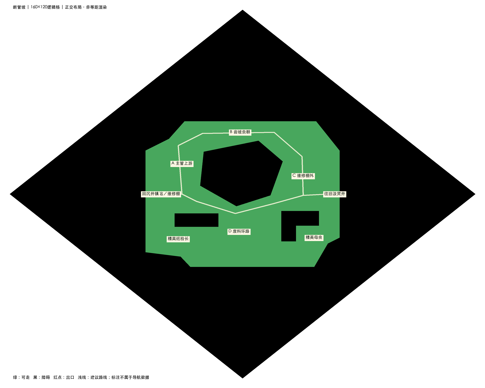
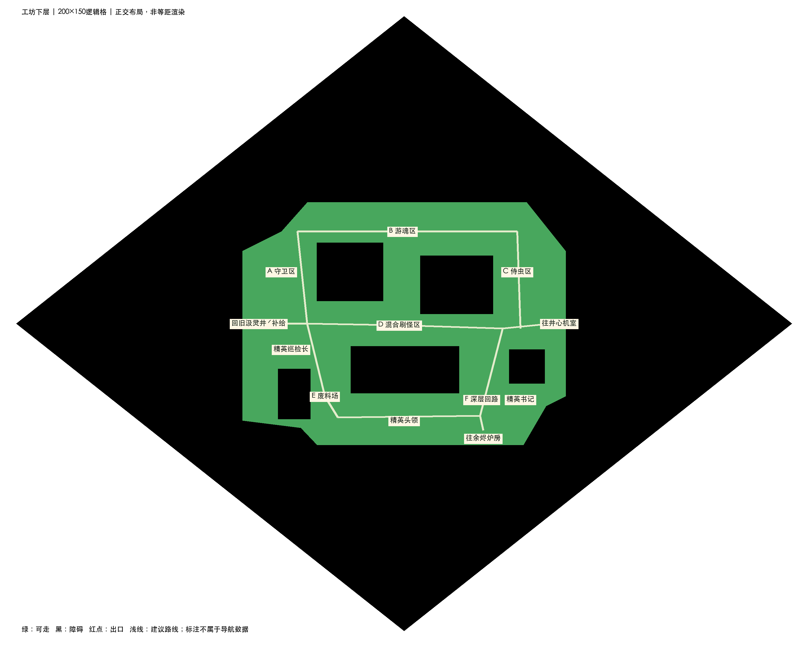
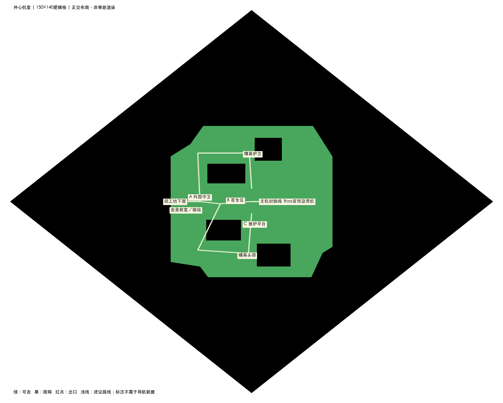

# 地图示意图交付与美术AI说明

日期：2026-10-13。状态：产品布局参考，供美术AI和关卡制作AI使用。

## 1. 后续协作规则

用户无需绘制或提供地图草图。产品侧负责提供故事用途、地图尺寸、区域与障碍布局、出口/入口、NPC与Boss位置、怪群区域、路径目标，以及必要的参考示意图。用户可以只描述体验偏好和修改意见。

美术AI依据产品资料制作正式场景视觉，关卡制作AI负责网格、碰撞、寻路与数据落地。参考图中的标注不直接作为可走遮罩，图像也不自动成为已经验收的地图。

## 2. 第二章六张地图（已全部提供示意图）

| 地图 | 尺寸 | 主要结构 | 出口 |
|---|---|---|---|
| 断管坡 | 160×120逻辑格 | 中央断崖、上下两条环路、4个主要怪群区、2处精英旁支 | 回沉井镇、往旧汲灵井 |
| 工坊下层 | 200×150逻辑格 | 两座厂房、中央废料池、上下环路、6个刷怪区 | 回旧汲灵井、往井心机室、往余烬炉房 |
| 井心机室 | 150×140逻辑格 | 前室、外围怪群、两侧维护台、主机封锁阀与独立Boss空间 | 回工坊下层 |
| 沉井镇 | 70×60逻辑格 | 中央炉塔、四组建筑、8名NPC服务区、备用炉预留与环形街道 | 回幸存者营地、往断管坡 |
| 旧汲灵井 | 140×180逻辑格 | 中央井口、外环平台、内侧维护路线、调压台Boss场与3处精英位 | 回断管坡、往工坊下层 |
| 余烬炉房 | 120×110逻辑格 | 中央熔坑、上下绕行路线、外环任务区、右侧可选Boss场 | 回工坊下层 |

本次采用尺寸评估文档12的建议，不自动修改文档11旧预算。主要区域坐标和障碍顶点已附JSON，全部为正交网格坐标；等距显示由游戏转换。

## 3. 文件如何使用

每张图提供四份文件：

- **标注示意.png**：有地名、怪群、精英、NPC与建议路线，用于让AI理解关卡意图。
- **纯色布局.png**：白背景、外层黑菱形、绿色地图矩形、黑色障碍与红色出口，符合用户此前的参考表达方式。
- **导航参考.png**：只截取地图矩形，不含外框、文字、路线、红点；用于整理可走区域，不可不经检查直接导入游戏。
- **布局参考.json**：地图格数、障碍顶点、出口、标注和建议路线坐标；作为制作参考，不是当前maps.json的直接替代文件。

外层黑菱形只负责展示，不是地图边界，也不参与导航。地图边缘黑区与内部障碍共同构成不规则可走范围。每张图的出口数量遵循实际交通关系，因此井心机室只有一个，工坊有三个。

### 断管坡

[标注示意](地图示意图/断管坡-标注示意.png) · [纯色布局](地图示意图/断管坡-纯色布局.png) · [导航参考](地图示意图/断管坡-导航参考.png) · [坐标参考](地图示意图/断管坡-布局参考.json)



### 工坊下层

[标注示意](地图示意图/工坊下层-标注示意.png) · [纯色布局](地图示意图/工坊下层-纯色布局.png) · [导航参考](地图示意图/工坊下层-导航参考.png) · [坐标参考](地图示意图/工坊下层-布局参考.json)



### 井心机室

[标注示意](地图示意图/井心机室-标注示意.png) · [纯色布局](地图示意图/井心机室-纯色布局.png) · [导航参考](地图示意图/井心机室-导航参考.png) · [坐标参考](地图示意图/井心机室-布局参考.json)



## 4. 可直接发给美术AI的说明

### 补齐的三张地图文件

**沉井镇**：[标注示意](地图示意图/沉井镇-标注示意.png) · [纯色布局](地图示意图/沉井镇-纯色布局.png) · [导航参考](地图示意图/沉井镇-导航参考.png) · [坐标参考](地图示意图/沉井镇-布局参考.json)

**旧汲灵井**：[标注示意](地图示意图/旧汲灵井-标注示意.png) · [纯色布局](地图示意图/旧汲灵井-纯色布局.png) · [导航参考](地图示意图/旧汲灵井-导航参考.png) · [坐标参考](地图示意图/旧汲灵井-布局参考.json)

**余烬炉房**：[标注示意](地图示意图/余烬炉房-标注示意.png) · [纯色布局](地图示意图/余烬炉房-纯色布局.png) · [导航参考](地图示意图/余烬炉房-导航参考.png) · [坐标参考](地图示意图/余烬炉房-布局参考.json)

沉井镇黑色建筑块代表占地障碍，NPC标注安排在屋外可走区域；炉塔为不可穿行的中央地标。旧井的“上层”“下层”表达场景气氛，仍是同一平面的导航，不要求真实跨层。余烬炉房的外环组件任务不用击败右侧可选Boss，主线和可选挑战应保持隔离。

```text
请依据附带的标注示意图和纯色布局图，设计《末法时代》第二章地图。
正交布局图表达的是逻辑区域，游戏最终采用等距斜角显示。

保留地图整体区域关系、出口连接、主要障碍位置、循环路线和Boss空间。
外层黑色菱形只是展示外框，不属于地图，不要把它做成一圈墙或额外地形。
绿色是可活动区域，内部及边缘黑色区域是不可走障碍。
红点是出口标注，浅色线是路线说明，文字标签都不属于最终场景贴图。

断管坡：岩坡、破裂输灵管、维修棚与废料区，灰褐地面、少量紫色泄漏。
工坊下层：废弃砖墙车间、管道、铆钉机械和废料池，铜绿与暗灰为主。
井心机室：巨大采灵装置、紫色寄生结构、环状主管；Boss场地保持开阔。
沉井镇：山坳里的蒸汽小镇、中央炉塔、汤棚和维修工坊，保留便利的服务街道。
旧汲灵井：干涸井口、环形维修平台、铁桥和调压台；高度差只作视觉表达。
余烬炉房：暖橙炉光、黑色炉渣、中央熔坑与备用供暖设备；主线外环独立于可选Boss。

请把可走通道、不可走障碍和装饰分层，避免仅靠颜色暗示碰撞。
大型装饰不得遮挡角色脚底、出口与Boss预警；不添加参考图之外的封路障碍。
地图逻辑格数以文档和坐标参考为准，不以图片像素数作为游戏地图格数。
如果制作等距整图，保留正交布局对应关系；不要把示意图直接斜切后当作完成地图。
```

## 5. 落地时需要校准的内容

参考图已按规划给出区域关系，但尚未验证实际寻路、休整区保护、通道净宽、怪群位置、面积比例和路径时长。出口附近的休整范围需在制作时明确绘制到导航数据，不能仅凭红点推断。

尤其是入口到出口的示意主路，当前未刻意绕行到文档12的30—60秒目标；制作时要按世界距离计算调整，以合适区域体验为准，不能声称参考图已经达到该时长。怪物数量按区域预算另行投放，示意图不逐只画怪。

井心图的Boss位置需要落实为至少18格直径的可走战场，并配套普通怪隔离、入口门与休整区。标注中的Boss文字不是实际Boss碰撞尺寸。

正式关卡完成后由开发检查连通、碰撞与自动战斗路径。上述工作由制作流程承担，用户无需补画草图。
