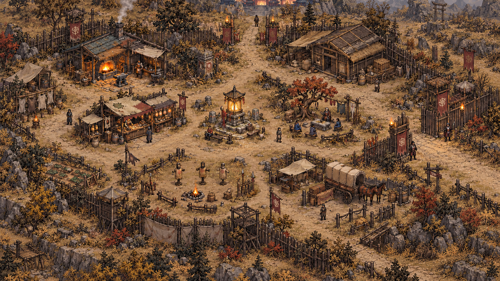

# 幸存者营地 · 整图视觉设计稿 v1

本稿用于确认第一章「幸存者营地」的**最终画面方向和整体构图**，不是运行素材，也不作为现成的逐格布局。确认前不拆分素材、不修改地图数据或游戏场景。

## 设计依据

- 现有营地为 `64×36` 逻辑格；镇灵灯、长老、货郎、铁匠、仓库管理员、车夫、三只教学木桩均需在营地内保留。
- 北侧连接第二章，东侧连接试炼野外。服务集中在镇灵灯周围，玩家能辨认主要目的地。
- 延续当前源图的旧木、补丁帆布、石材、暖土、铁器与克制火光。现有场景截图中的重复建筑、规整深色方形底座和大面积棋盘铺装不作为新画面的结构。
- 用户要求的矩形是**屏幕中看到的整张地图轮廓**，而非仅在程序数据里保存一个矩形格子数组。稿件按约 16:9 的横向矩形画幅组织，保留物件的等距视角。

## 画面结构

- 横向的踩实土路串联服务点与右侧野外出口；石板只在高使用率的局部自然出现，边缘不形成直尺一样的道路带。
- 镇灵灯作为中心焦点，附近保持可阅读的空场。货郎在其左侧，长老议事角在右侧；铁匠与仓库分别在上方两侧，形成不同轮廓。
- 北侧道路抵达画面上缘的第二章方向；右侧出口由木门、旗帜和道路尽头共同指向试炼野外。
- 下方训练场有**三只**木桩；车夫的马车与停靠点位于右下方。外围以修补的木栅、布棚、岩石及干草收束，留有有意安排的疏密变化。
- 大型建筑、栅门、马车与灯均作为完整实体构思，后续分拆时保持整体轮廓，不按 1×1 格切成碎片。小型石块、干草和杂物才适合作为单格点缀。

## 需要确认的视觉决策

这张图确定的是整体视觉方向、区域关系、疏密和材质语汇。树、栅栏和马车属于本稿提出的补充元素，是否保留由本轮视觉确认决定。画面中的人物与小道具用于展示空间尺度；后续仍以游戏现有角色、NPC 和交互对象为准。原画获确认后，再依据画面反推可达区域、建筑足迹、遮挡和碰撞，而不是用当前方形障碍块复刻原画。

## 制作记录

- 方法：内置 imagegen；先生成整图，再定向修正训练木桩数量、镇灵灯色彩和边缘水景。
- 画幅：1672×941 像素；文件为概念原画，仅供设计确认。
- 最终修订提示词：`Edit the preceding full-map Survivor Camp visual concept. Preserve the complete 16:9 screen-aligned rectangular composition, building locations, isometric view, organic service street, top-center exit and right-edge gate. Show exactly three practice dummies; change the central spirit lantern to restrained amber-gold; replace streams and waterfalls with dry earth, rock, sparse scrub and broken palisade; reduce vegetation saturation toward muted ochre, dark timber, dusty olive and warm firelight. Keep clear walking space. No labels, text, grid, HUD, checkerboard or diamond-shaped map boundary.`
