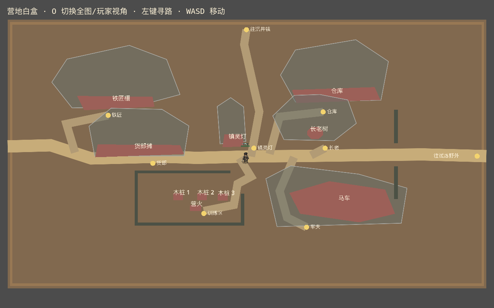
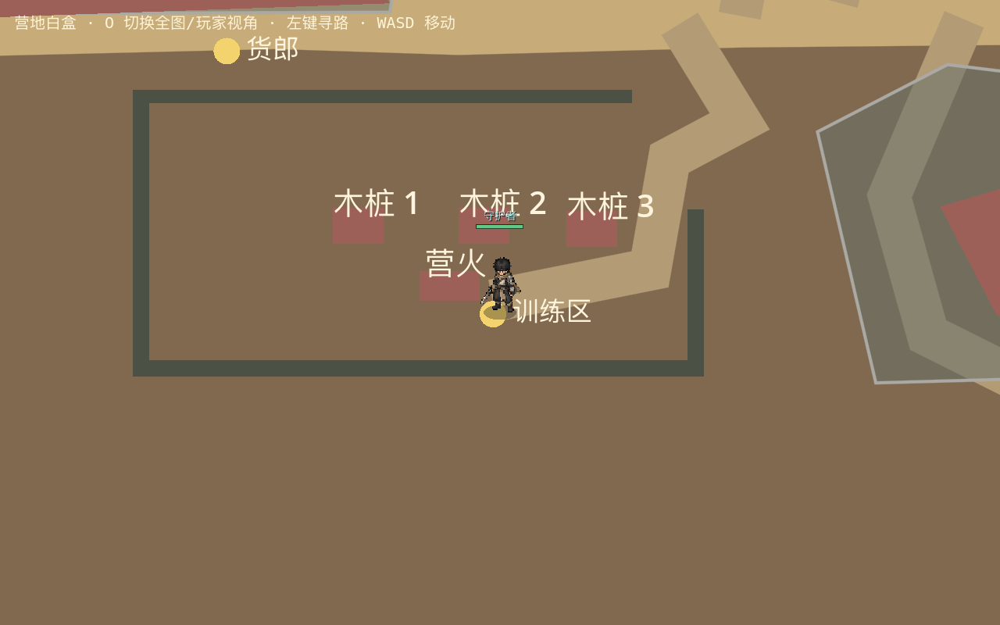

# 幸存者营地 · 等比例可玩白盒 v1

本样板把[整图视觉设计稿](幸存者营地-v1.md)及[通行与实体覆盖图](幸存者营地-通行与实体覆盖图-v1.md)中的主要结构映射到 Godot 世界坐标，验证屏幕矩形、玩家尺度和关键路线。它位于 `tests/CampWhitebox.tscn`，**不会替换正式营地或进入正常游戏流程**。

## 比例与操作

- 原画坐标：`1672×941`；白盒世界矩形：`3200×1800`，位于世界坐标 `(-1600,-2660)` 起。横纵比例系数分别约为 `1.914` 与 `1.913`，没有通过拉伸玩家或物件制造 16:9。
- 导航使用现有 `Iso` 的 **64×32** 等距格中心；为包住屏幕矩形，白盒网格为 `110×110`。矩形外的等距格不能行走，矩形地面由单块几何绘制，没有逐格地面节点。
- 玩家直接使用现有 `Player.tscn`、移动脚本与半径 `12` 世界像素的圆形碰撞。白盒的格中心以 `14` 世界像素留边筛选。
- 在 Godot 中运行 `tests/CampWhitebox.tscn`：`O` 切换全图与玩家原尺寸视角；左键点击寻路；`WASD`/方向键手动移动。概览镜头只供检查整图，平时应切到玩家视角判断通道体感。
- `tests/fixtures/camp_whitebox_v1.json` 是白盒唯一实体轮廓事实源；同一多边形同时用于物理碰撞和 A* 通行掩码。屋顶、树冠的 `visual` 范围只绘制，不阻挡。

## 实际验收

2026-10-15 在 Godot GL Compatibility、`1280×800` 实际窗口与隔离测试项目中执行 `python3 tools/run_isolated_tests.py --rendered CampWhiteboxAcceptance`：

| 检查 | 结果 |
| --- | --- |
| 世界外轮廓 | 16:9 屏幕对齐矩形；全图截图无斜切外边界 |
| 矩形内部等距格 | 5,495 格；其中 5,013 格可走，约 **91.2%** |
| 实体碰撞 | 10 个大型/小型地标及 6 段围栏，共 16 条独立静态轮廓；另有 4 条地图外边界 |
| 目标路线 | 铁匠、仓库、货郎、长老、车夫、镇灵灯、训练区、北门、东门，共 9 个点均可规划路线 |
| 真实移动 | 现有玩家角色从营地中心分别实际移动到上述 9 点，均在帧数上限内到达；训练围栏和东门开口实际可通过 |
| 单次加载 | 测得首次布局、导航和玩家装配约 `55 ms`；仅作这次设备/隔离场景的记录，不代表正式地图加载成本 |

导航与碰撞都由加载阶段建立；每帧仅更新正在行走的玩家路线，不扫描整张网格，也不生成逐格节点。白盒 A* 持有 `110×110` 格状态，实际内存与正式游戏并行系统的综合成本尚未测量。

## 结论和边界

白盒证明：在设计稿的建筑占地与服务区关系下，**视觉复杂度并不迫使可行动区域变窄**；全图矩形也能与现有等距坐标、玩家碰撞和实际移动共存。训练区和东门需要的开口已在白盒中落实，正式美术拆分时必须把开口明确画出来。

本阶段没有验证原画像素级复刻、64×32 纹理地砖如何在矩形边缘裁切、建筑前后遮挡、NPC 对话触发、出口切图、旧存档坐标迁移、正常游戏中的完整性能或稳定帧率。现有正式营地仍是 `64×36` 的斜边投影布局；白盒的 `110×110` 边界与坐标只是将视觉稿转成可玩几何的一种方案，不能未经实机美术样板验证就直接整体迁入正式游戏。下一道关口应制作**局部 1:1 美术实机样板**：优先还原镇灵灯、货郎摊、主路、训练场开口与一段外围，再比较原画和实际游戏截图。
