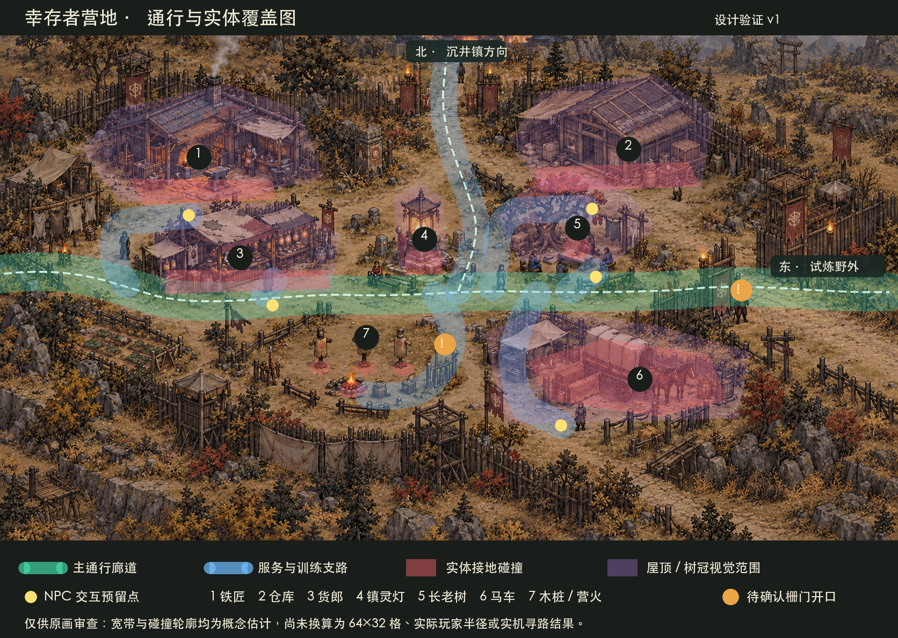

# 幸存者营地 · 通行与实体覆盖图 v1

本图叠加在[整图视觉设计稿](幸存者营地-v1.md)上，用于在拆素材和写地图数据之前审查**通行、碰撞和视觉遮挡的关系**。它是设计判断，不是经过 Godot 寻路或碰撞验证的运行地图。

可编辑源文件：[幸存者营地-通行与实体覆盖图-v1.svg](幸存者营地-通行与实体覆盖图-v1.svg)。图中青色宽带是必须预留的横向主通道，蓝色宽带是通往服务点、北侧出口、训练区和车夫的支路；黄色点为 NPC 交互位置的预留。红色是大型实体**接地处**拟设置的碰撞范围；紫色是屋顶、棚面和树冠等视觉范围，不能把整片紫色范围都变成不可通行区。

## 实体与通行判断

| 编号 | 视觉实体 | 拟阻挡范围 | 应保留的可达空间 |
| --- | --- | --- | --- |
| 1 | 铁匠棚 | 炉台、建筑脚与固定工具 | 南侧前场供玩家接近铁匠 |
| 2 | 仓库 | 建筑脚、堆货底部 | 南侧前场供玩家接近管理员 |
| 3 | 货郎摊 | 摊台与立柱底部 | 南侧柜台及主路净空 |
| 4 | 镇灵灯 | 石座底部 | 四周绕行，主路从灯下方通过 |
| 5 | 长老树与议事角 | 树干、固定石座 | 树冠下仍可活动，议事角从南侧到达 |
| 6 | 马车停靠区 | 马车、马匹和固定货堆的实际接地轮廓 | 停靠区西南侧接近车夫，主路不被车身堵断 |
| 7 | 训练区 | 三只木桩和营火各自独立的小范围 | 玩家从东侧入口进入，并能绕行与攻击木桩 |

围栏、干草、小石块和布幔需逐件判断。围栏实体只能阻挡实际立柱和围挡；其间的门洞必须真正可走。浅草、地面碎石和脚印只是地面装饰，不应因此剥夺通行。

## 本图发现的两处改动需求

1. **训练场东侧围栏**：原画看起来可能封住了蓝色支路。落地时必须做一个和原画材质一致的明确开口，保证玩家能进入训练场并绕到三只木桩的位置。
2. **东侧野外出口**：画中的门架、栅栏与旗帜很密。出口位置必须留贯通开口，不能只用路面颜色暗示可以切图。

上方通往沉井镇的门道也应在转化为运行布局时检查遮挡和净宽。此处暂未发现必须修改原画的冲突，但不能仅凭视觉图判定已经可走。

## 落地验证边界

当前玩家的碰撞圆半径是 `12` 世界像素，已有路径平滑检查采用 `14` 世界像素的留边。原画的 `1672×941` 画布像素与世界像素、`64×32` 地砖、逻辑格坐标并无固定换算关系，因此本图上的彩带宽度**不表示已经合格的实际通道宽度**，红色轮廓也不是最终碰撞多边形。待整图和本覆盖图获确认后，先建立视觉坐标到运行地图的对应，再由同一布局事实源生成通行、寻路和碰撞；检查玩家从两个入口到五名 NPC、镇灵灯、车夫和三只木桩的实际移动，以及围栏开口、屋顶遮挡和右侧出口切图。

图的结论是：**这张原画有保留充足通行空间的构图余地**，无需先删减建筑或降低整体细节；训练场入口和东侧栅门是开发前必须明确处理的局部问题。是否最终达到顺畅移动，仍以游戏内实测为准。

制作方式：以整图设计稿为底，在 SVG 中人工绘制通行带、实体足迹和交互点；PNG 由 ImageMagick 按仓库中的 SVG 渲染。SVG 与底图位于同一目录，以相对路径引用底图。
