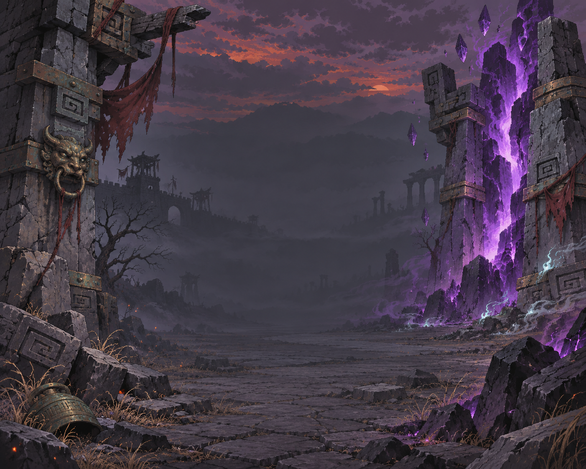
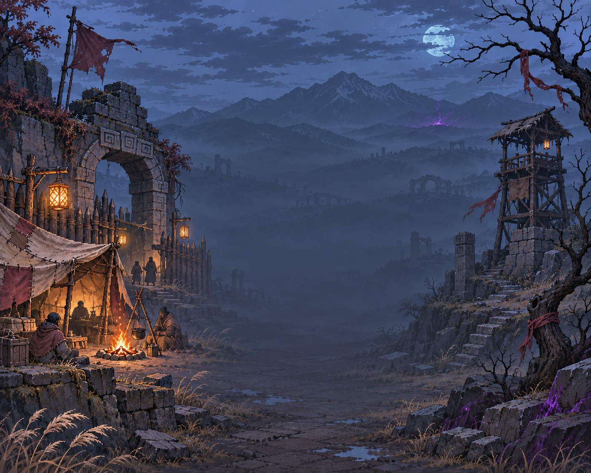
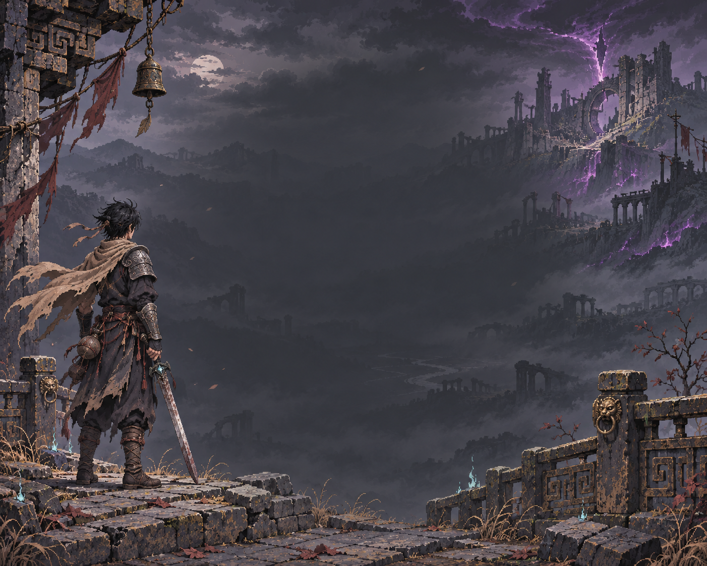

# 主菜单专用背景候选

本轮交付三张背景设计候选，等待用户选定，尚未接入运行资源或修改菜单代码。

后续状态（2026-11-10）：用户确认三张全部使用，已接入每次启动随机背景；以下保留候选阶段的设计记录。最终采用原图等比铺满和居中裁切，未重新扩图。运行规格见 [运行素材说明](../../../assets/ui/menu_backgrounds/README.md)，验证见 [实施记录](../../工程文档/2026-11-10-主菜单随机背景实施记录.md)。

## 设计依据与边界

- 当前 `scripts/ui/menu_panel.gd::_build()` 使用居中菜单和透明度 0.84 的全屏深色遮罩，背后仍是游戏世界，并非独立背景贴图。
- `project.godot` 的基准视口为 1280×800（16:10）；候选图实际尺寸需按下方文件检查记录理解，提示词中的比例不是生成结果保证。选定后扩图到 16:10，不直接拉伸，再验证 16:9 与窗口缩放的裁切。
- 题材取自《02 世界观与剧情设定》和《01 视觉与技术统一规范》：灵气衰竭、人类废墟、紫色异界裂隙、旧铁铜与布革。候选属于主菜单插画，不替代游戏内等距地形规格。
- 中央保留低对比区域，主要景物放在两侧，供现有居中菜单使用。未叠加实际菜单，因此可读性尚待接入预览验证；正式接入时应重新评估原有深色遮罩强度。

## 候选

| 编号 | 主题 | 侧重 |
|---|---|---|
| A | 裂隙之门 | 破碎城门、紫色裂隙，压迫感与世界观 |
| B | 余烬营地 | 暖色营火、冷色荒野，生存与归途 |
| C | 守护者远征 | 守护者背影、失落疆域，人物代入与冒险；推荐方向 |

## 来源与状态

三张图片均使用内置 image_gen 工具生成，无外部下载素材。守护者造型参考已查看的项目头像之文字特征；并非严格角色形象复刻。授权范围为用户要求的候选设计，尚未获得定稿确认。这里只归档候选源稿，不增加运行纹理依赖、不改变暂停/存档/设置逻辑。本轮仅目视检查构图、风格和文字缺失，不运行无关功能测试，不作运行性能声明。

## 完整生成提示词

### A-裂隙之门



```text
Use case: stylized-concept. Create a standalone dedicated main-menu background candidate for a Chinese dark fantasy single-player ARPG, Degenerate Age. Landscape 16:10 composition matching 1280x800 game window. Polished detailed retro pixel-art illustration with deliberate crisp pixel clusters and controlled stepped shading, mature atmospheric art, not a screenshot, not a tile map, not smooth 3D, not photorealism. World: depleted spiritual energy, ruined human civilization, patched cloth, aged iron and bronze, sparse purple otherworld corruption and tiny cyan-white spiritual energy accents. Asian-inspired worn stonework with restrained geometric carvings, no lavish imperial palaces, no sci-fi technology. Main menu is centered: reserve central x36%-64%, y24%-84% as continuous subdued dark mist or low-detail scenery so a centered opaque menu will not hide the main artwork. Put main focal subjects to either side, coherent full scene not a blank rectangle. Edge crop safe. No text, no letters, no title, no buttons, no interface, no watermark, no border. This is a preview-only original art direction, not an implementation. Variant A: RIFT GATE. A panoramic slightly elevated view into a ruined ancient frontier gateway in an ash wasteland at dusk. Huge weathered broken gate pylons frame the left and right edges; broken bronze bindings and restrained geometric spirit-channel engravings. At the RIGHT third a jagged vertical violet interdimensional fissure glows between fractured stone pillars, small sharp crystals floating nearby. At the LEFT third deep silhouettes of ruined walls and bare trees. The center is a broad dark empty stone approach receding through charcoal haze. Powerful monumental silhouettes, cold iron gray, muted bronze, bruised violet restrained to right third, a few amber embers. Foreground rubble forms framing corners. Ominous but beautiful, strong sense of an ancient world breached, no characters necessary. Crisp handcrafted pixel-art title screen, atmospheric distance with stepped value bands.
```

### B-余烬营地



```text
Use case: stylized-concept. Create a standalone dedicated main-menu background candidate for a Chinese dark fantasy single-player ARPG, Degenerate Age. Landscape 16:10 composition matching 1280x800 game window. Polished detailed retro pixel-art illustration with deliberate crisp pixel clusters and controlled stepped shading, mature atmospheric art, not a screenshot, not a tile map, not smooth 3D, not photorealism. World: depleted spiritual energy, ruined human civilization, patched cloth, aged iron and bronze, sparse purple otherworld corruption and tiny cyan-white spiritual energy accents. Asian-inspired worn stonework with restrained geometric carvings, no lavish imperial palaces, no sci-fi technology. Main menu is centered: reserve central x36%-64%, y24%-84% as continuous subdued dark mist or low-detail scenery so a centered opaque menu will not hide the main artwork. Put main focal subjects to either side, coherent full scene not a blank rectangle. Edge crop safe. No text, no letters, no title, no buttons, no interface, no watermark, no border. This is a preview-only original art direction, not an implementation. Variant B: EMBER REFUGE. A broad slightly elevated panorama of the last human refuge at blue twilight amid a desolate ruined valley. On the LEFT third, a small patched canvas shelter, timber palisade and old stone arch, warm amber campfire and lanterns, humble repaired materials, a few tiny indistinct survivor silhouettes. RIGHT third contains a broken watchtower, dry black branches and distant mountains, a very small violet crack glowing far on the horizon. The CENTER is a calm dark misty path leading into the valley, largely quiet negative space for the existing centered menu. Contrast safe warm tiny refuge versus vast cold ash wilderness. Emotional, restrained hope and longing to explore, earthy umber, slate blue, old linen, ember gold; no lush fantasy palace or modern objects. Deliberately detailed crisp retro pixel illustration, no blurry painting.
```

### C-守护者远征



```text
Use case: stylized-concept. Create a standalone dedicated main-menu background candidate for a Chinese dark fantasy single-player ARPG, Degenerate Age. Landscape 16:10 composition matching 1280x800 game window. Polished detailed retro pixel-art illustration with deliberate crisp pixel clusters and controlled stepped shading, mature atmospheric art, not a screenshot, not a tile map, not smooth 3D, not photorealism. World: depleted spiritual energy, ruined human civilization, patched cloth, aged iron and bronze, sparse purple otherworld corruption and tiny cyan-white spiritual energy accents. Asian-inspired worn stonework with restrained geometric carvings, no lavish imperial palaces, no sci-fi technology. Main menu is centered: reserve central x36%-64%, y24%-84% as continuous subdued dark mist or low-detail scenery so a centered opaque menu will not hide the main artwork. Put main focal subjects to either side, coherent full scene not a blank rectangle. Edge crop safe. No text, no letters, no title, no buttons, no interface, no watermark, no border. This is a preview-only original art direction, not an implementation. Variant C: GUARDIAN'S EXPEDITION. On the LEFT third foreground stands one small-to-medium full-body young guardian seen from behind in three-quarter rear view, black tousled hair, sand-colored scarf with a few worn ends, practical dark cloth and leather, weathered steel shoulder armor and bracers, long sword held down with a tiny cyan accent near its hilt. The character occupies roughly 40% of image height and must stay outside the middle menu area. Looking across a lost realm from a broken stone terrace. On RIGHT third, huge distant jagged ruined citadel and a restrained violet tear above its shattered ridge. Center is deep dark atmospheric valley and low-detail rolling charcoal mist, enough calm space for a centered vertical menu. Crumbling bronze-carved railing at edges, sparse ash drifting, muted iron gray, sand cloth, bronze highlights and restrained violet/cyan. Epic journey invitation with human scale, cinematic wide environment painted as crisp detailed retro pixel art, no glossy anime poster, no giant face close-up.
```


## 实际文件规格

- A-裂隙之门：实际 1402×1122，PNG，候选原稿。

- B-余烬营地：实际 1402×1122，PNG，候选原稿。

- C-守护者远征：实际 1402×1122，PNG，候选原稿。
