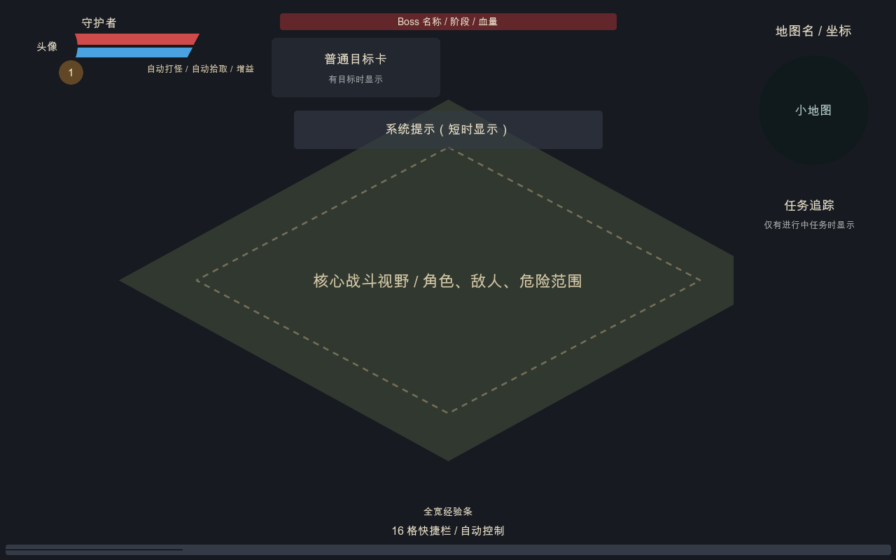

# HUD 布局与玩家状态区样板（质感修订）

本稿以工程默认的 **1280×800** 视口为基准。左上角保持无总背景的头像、姓名、血蓝槽和小图标组合。头像有刻纹、双层金属边和铆钉；等级圆章有内外金属环、暗色底与局部高光。玩家姓名使用略小的加粗字。HP/MP 槽分别长 180/170 px、高 16/14 px，位于头像后方；它们的右侧沿同一斜线收口。图标间距为 3 px。布局示意表达区域与信息优先级，不是最终游戏贴图。实机图见 [营地](营地实机.png)、[洞穴](洞穴实机.png)和[自动开启](自动开启实机.png)。

| 区域 | 基准位置 | 显示规则与职责 |
|---|---|---|
| 玩家状态 | 左上 `(16,16)` 起，无整体底板 | 88 px 装饰圆头像、贴在头像下缘的 35 px 金属等级徽章、17 px 加粗姓名、藏在头像后方的 180/170 px HP/MP 槽；槽上无数字 |
| 自动状态与增益 | 蓝槽下方，每枚 24×24 | 自动打怪和自动拾取独立显示：开启点亮、关闭变灰、暂停加标记；战意觉醒出现时追加第三枚图标 |
| 普通目标 | 玩家区右侧 `(388,54)`，240×84 | 有有效普通目标时显示；Boss 使用专用血条 |
| Boss 血条 | 顶部居中，480×18 | 交战时显示名称、血量和阶段；与普通目标卡错开高度 |
| 系统提示 | 上中 `(420,158)` 起 | 短时提示；避开目标卡和 Boss 血条 |
| 小地图 | 右上 `(1060,16)`，204×236 | 地图名、坐标、地图、设置入口；地图可打开大地图 |
| 任务追踪 | 小地图下 `(1048,260)` 起 | 有进行中任务时出现；任务文字和寻路链接继续保持交互 |
| 快捷栏 | 底部居中 | 保留现有 16 格和键位行为 |
| 经验条 | 底边全宽 | 与快捷栏分层，仍随玩家经验实时更新 |

## 本轮接入

玩家状态区使用 96×96 守护者头像资源，形象与世界角色保持黑色短发、土黄色披肩、旧铁护肩和少量青色灵能细节。头像由 [原图](../../../../art_source/ui/guardian_portrait_source.png) 缩为 [游戏资源](../../../../assets/ui/portraits/guardian.png)，在 Godot 内以圆形遮罩显示。血蓝槽和状态图标由 Godot 绘制，仍绑定真实 HP/MP、自动打怪、自动拾取、手动接管、打坐和增益状态；悬停细槽可看精确数值，悬停图标可看状态与快捷键。

HUD 不再显示金币和背包数量；两项信息仍可在背包界面查看。旧的文字节点继续接收事件但隐藏，以保持现有自动状态和输入反馈检查的语义接口。头像框不烘进头像，后续 NPC、怪物头像可共用。

本轮仅把玩家状态区做成正式可玩的视觉样板。普通目标、小地图、任务追踪、快捷栏和弹出面板的美术暂沿用当前实现；后续按同一配色、边框和字号系统逐项替换。制作时优先处理：普通目标与 Boss 战同屏、任务列表展开、小地图洞穴轮廓、自动战斗状态，以及 80%/100%/150% UI 缩放的可读性。

## 复现

Godot 运行 `scenes/ChapterOneArtSample.tscn` 可在营地试玩。执行 `Godot --path . res://scenes/ChapterOneArtSample.tscn -- --hud-capture` 可生成无样板说明文字的营地实机图；追加 `--hud-demo-active` 可预览两个自动状态点亮。洞穴截图来自 `scenes/CaveArtSample.tscn`。布局和数据事件使用现有 HUD 场景。
