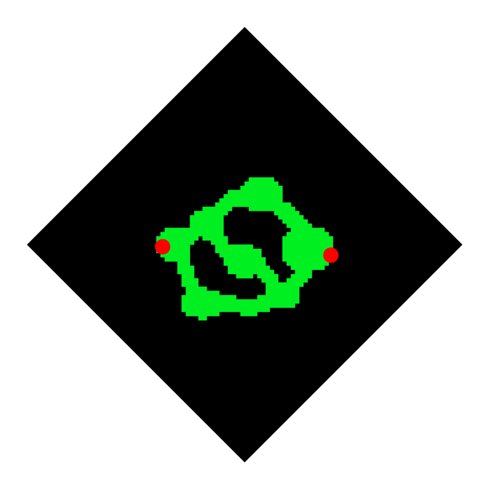

# 腐化源头：地下洞穴布局 v2

这版根据洞穴参考图重做了地图的正负形关系：**可走地面只由洞室和通道构成，其他区域全部是黑暗**。外层菱形只表达等距画面的规划边界，不是地面轮廓。规划草图保留纯平面色块；游戏内由同一份 50×50 网格生成等距地面、洞壁碰撞与小地图轮廓。

## 空间组织

从左侧 `(8,25)` 洞口进入，经过前厅后可走上层通道或下层回环。上层通道通往北部洞室；下层通道经过车夫所在的中部洞室、南部洞室，最终与上层路线在右侧 Boss 洞室汇合。Boss 固定在 `(40,26)`。现有“返回灰烬之地”出口仍在 `(5,25)`；右侧红点 `(45,27)` 只是规划出口，没有接入游戏。

规划数据在 `data/cave_layout.json`：`chambers` 与 `passages` 定义洞室和通道，`walkable_rows` 是构建脚本生成的 50×50 可走掩码。运行时代码仅读取掩码，确保地面、碰撞、寻路与小地图遵守同一份通行结果。运行 `python3 tools/build_cave_layout.py` 可校验四向连通性并重建掩码与 SVG 草图。当前有 **624 个连通可走格，占网格 25.0%**；全部关键点可达。

## 游戏内实现与视觉

`IsoGround` 只在可走格铺暖色石灰岩地砖，并压低地砖亮度，保持洞内昏暗；黑暗覆盖洞穴外所有视野。洞壁只绘制在黑暗与地面相接的画面后侧边缘，向下垂到可走地面。绘制前先收集连续墙段并统计端点：相接处保持完整岩层，真正的末端收成不规则斜角，避免连续锯齿处出现一排方切的断墙。画面前侧边缘只用细岩缝衔接，不绘制向黑暗下坠的崖壁，以免像山顶平台。可走边界阻挡实体；内部大片黑暗无需逐格创建碰撞。玩家点击移动、自动战斗和怪物追击会绕墙。怪物在可走格生成，Boss 固定在战斗洞室，读档位置、掉落物和召唤物会纠正到可走格。地图面板只显示已探索的可走洞穴轮廓。

地砖新原画为 `art_source/environment/cave_tiles_v2.png`，经 `tools/build_environment_art.gd` 打包为 `assets/tiles/cave/tile_0..3.png`。旧的蓝灰洞穴砖保留在 `art_source/environment/cave_tiles.png` 供比较；实机图见 [全图轮廓](全图预览.png)、[洞口](洞口预览.png)、[Boss 区](Boss区预览.png)。Boss 本体仍是原有占位外观，属于后续角色素材工作。

## 试玩与验收

Godot 打开 `scenes/CaveArtSample.tscn`，按 F6 从洞口直接试玩，不占用存档槽。命令行附加 `-- --art-boss` 可从 Boss 区旁预览，`-- --art-overview` 可看全图。建议重点检查洞口至 Boss 的两条路线、洞壁遮挡、地图面板轮廓，以及 Boss 技能在洞室内的躲避空间。

`tests/CaveLayoutTest.tscn` 检查关键点连通、洞壁物理碰撞、怪物刷新，并实际驱动玩家从洞口绕到 Boss 区。整章切图、自动控制和输入反馈回归也应通过。
